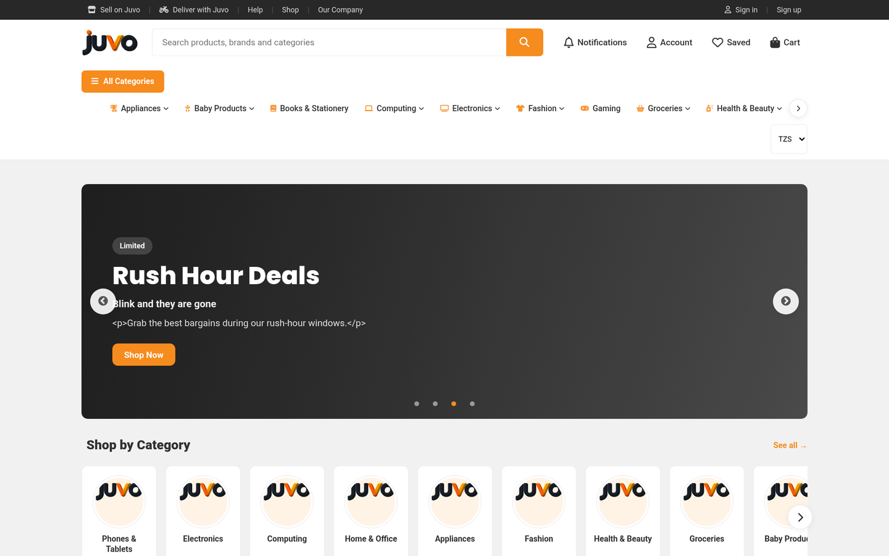
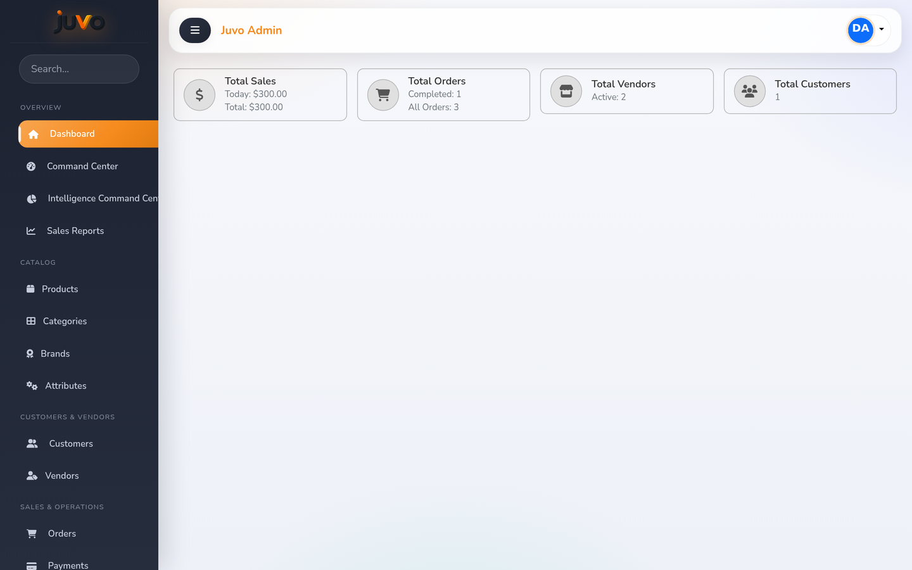
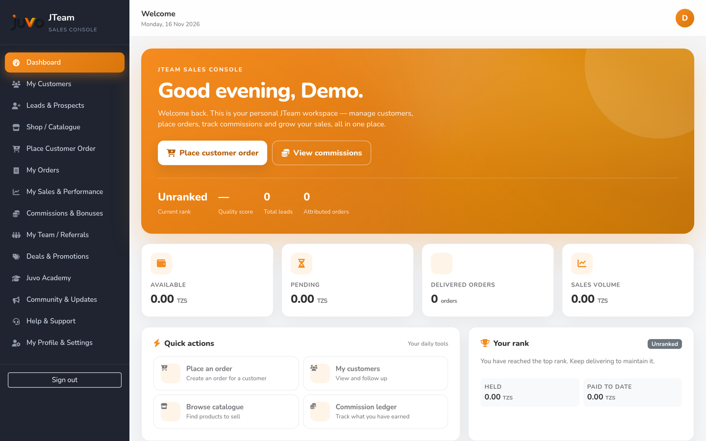
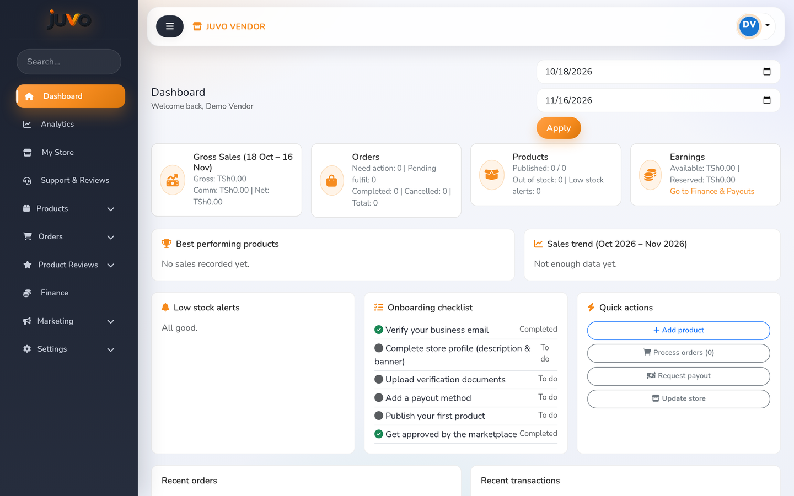
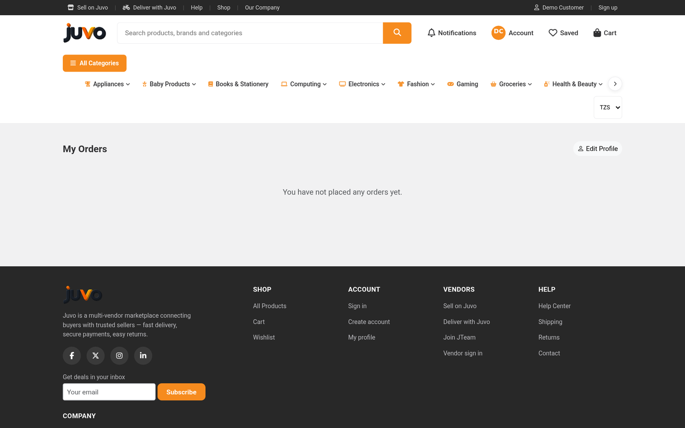
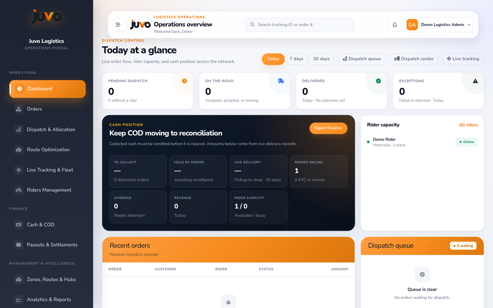
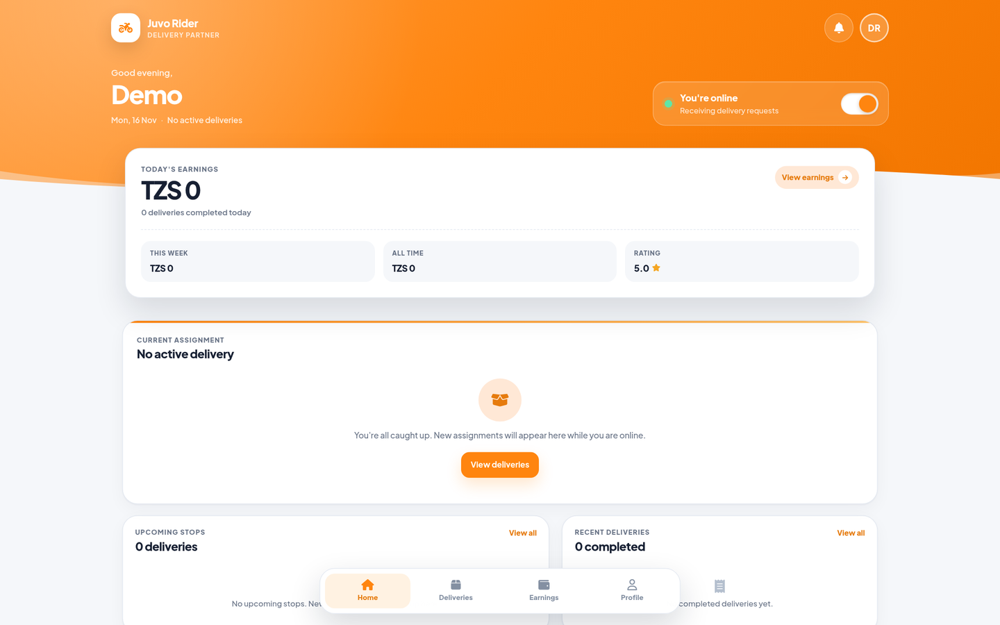
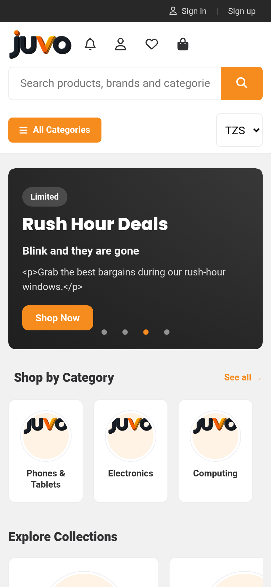
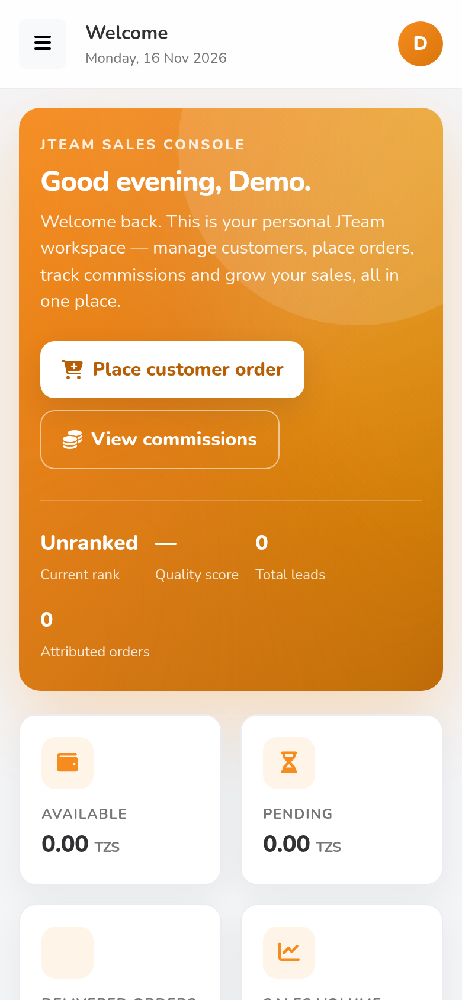

# Juvo Public Demo

Juvo is a multi-vendor Laravel marketplace with admin, vendor, customer, JTeam,
logistics, and rider portals.

This repository is a sanitized public copy. It contains application code only.
Deployment configuration, production hostnames, and provider-specific
infrastructure have been removed.

## Screenshots

These captures use the seeded demo data from a fresh local install.

<table>
  <tr>
    <td width="50%"><a href="docs/screenshots/storefront.png"></a><br><sub><b>Storefront</b></sub></td>
    <td width="50%"><a href="docs/screenshots/admin-dashboard.png"></a><br><sub><b>Admin dashboard</b></sub></td>
  </tr>
  <tr>
    <td width="50%"><a href="docs/screenshots/agent-dashboard.png"></a><br><sub><b>JTeam sales console</b></sub></td>
    <td width="50%"><a href="docs/screenshots/vendor-dashboard.png"></a><br><sub><b>Vendor dashboard</b></sub></td>
  </tr>
  <tr>
    <td width="50%"><a href="docs/screenshots/customer-orders.png"></a><br><sub><b>Customer orders</b></sub></td>
    <td width="50%"><a href="docs/screenshots/logistics-dashboard.png"></a><br><sub><b>Logistics operations</b></sub></td>
  </tr>
  <tr>
    <td width="50%"><a href="docs/screenshots/rider-dashboard.png"></a><br><sub><b>Rider dashboard</b></sub></td>
    <td width="50%"></td>
  </tr>
</table>

### Mobile

<p>
  <a href="docs/screenshots/storefront-mobile.png"></a>
  <a href="docs/screenshots/agent-mobile.png"></a>
</p>

## Requirements

- PHP 8.1 or newer
- Composer
- MySQL 8 or MariaDB 10.6+
- Node.js 18+ and npm (optional when `public/build` is already present)

## Get the code

```sh
git clone https://github.com/barakathedesire-byte/juvo-public.git
cd juvo-public
```

## Install

```sh
composer install
cp .env.example .env
php artisan key:generate
```

Create a MySQL database, then set these values in `.env`:

```dotenv
DB_CONNECTION=mysql
DB_HOST=127.0.0.1
DB_PORT=3306
DB_DATABASE=juvo
DB_USERNAME=root
DB_PASSWORD=
```

Run the migrations and demo seeders:

```sh
php artisan migrate --seed
php artisan storage:link
```

If the compiled frontend assets are missing, build them:

```sh
npm install
npm run build
```

Start the application:

```sh
php artisan serve
```

Open <http://127.0.0.1:8000>.

## Demo login

All portals use the same demo credentials:

```text
Username: admin
Password: admin
```

`admin@example.com` is also accepted in the login field.

Portal entry points:

| Portal | URL |
| --- | --- |
| Admin / staff | `/login` |
| JTeam sales console | `/agent/login` |
| Vendor | `/vendor/login` |
| Customer | `/customer/login` |
| Logistics | `/logistics/login` |
| Rider | `/rider/login` |

The demo seeder resets every account password to `admin` and creates or updates
the shared demo account for each portal.

To reset passwords again later:

```sh
php artisan db:seed --class=DemoAccessSeeder
```

## Demo mode warning

`.env.example` enables `DEMO_MODE=true`, which lets the login forms accept
`admin` as a username. Do not enable `DEMO_MODE` on a real deployment, and do
not reuse the demo credentials for production.

## Useful commands

```sh
php artisan migrate
php artisan db:seed
php artisan db:seed --class=DemoAccessSeeder
php artisan optimize:clear
php artisan route:list
php artisan test
```

## Tech stack

- Laravel 10
- Blade
- MySQL / MariaDB
- Laravel Sanctum
- Font Awesome (bundled locally)
- Vite

## License

Juvo is released under the [MIT license](LICENSE).
